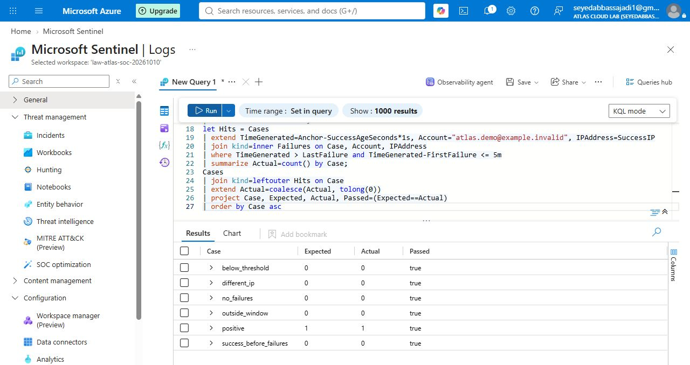
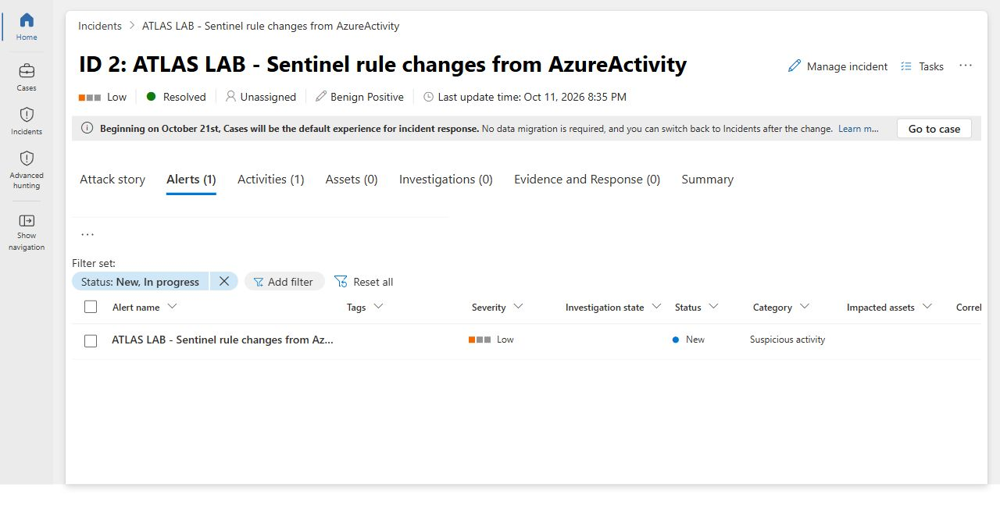
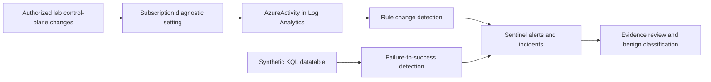

# ATLAS SOC Detection Engineering Lab

Microsoft Sentinel and KQL lab built in a disposable Azure Free Trial workspace in North Europe. The work separates **synthetic detection tests** from **real Azure Activity log ingestion** and records what was actually observed.

## Verified results — 11 October 2026

| Check | Observed result |
|---|---|
| Scheduled synthetic rule | Created and executed by Microsoft Sentinel |
| Incident pipeline | Incident 1 contained one alert, one event and IP entity `192.0.2.10` |
| Triage | New → Active → Closed; classified Benign Positive with an explicit lab rationale |
| Detection logic tests | Six KQL cases passed in Azure Log Analytics: one positive and five negative controls |
| Real ingestion | AzureActivity contained the lab's tag write, analytic-rule write and workspace configuration events |
| Control-plane detection | A second scheduled rule matched a real AzureActivity analytic-rule write and created incident 2 with one alert; resolved as expected security testing |

The synthetic incident is a real Sentinel object generated from deliberately synthetic data. It is **not evidence of a real attack, real failed sign-ins, or an Entra sign-in connector**. See [validation](docs/VALIDATION.md) and [triage](docs/TRIAGE.md).

Incident 2 had no populated entities in the Defender graph. Resource entity enrichment was configured but not validated as working. Its 24-hour lookback replayed an earlier authorized lab change; elapsed time is not an ingestion-latency measurement.

## Architecture

No virtual machines, attack infrastructure, real password attempts, paid playbooks, notebooks or third-party products were needed.

## Repository map

- `queries/01-synthetic-pipeline.kql`: exact synthetic rule logic used in the lab; includes a fixed expiry guard.
- `queries/02-synthetic-test-matrix.kql`: deterministic, repeatable positive and negative logic tests.
- `queries/03-azureactivity-rule-changes.kql`: actual control-plane rule query used in Sentinel.
- `queries/04-ingestion-validation.kql`: query for checking real ingestion without publishing caller identities.
- `docs/RUNBOOK.md`: build, validation and cleanup procedure.
- `docs/VALIDATION.md`: evidence and limits of the claims.
- `docs/TRIAGE.md`: incident handling record.
- `docs/DETECTION-DESIGN.md`: design choices and production limitations.

## Reproduce safely

Run the deterministic test matrix in a KQL workspace first. It should return six rows with `Passed == true`. The two scheduled queries retain their original expiry dates, so they intentionally stop returning detections after the lab window. Review cost coverage, replace the group name and deliberately set a short new expiry before any separate deployment.

The lab used a 100 MB daily ingestion cap and a small budget with early alerts. **Neither is an exact spending cap.** Azure Free Trial credit protection and avoiding excluded products were the financial boundary. See the companion [Azure observability and governance lab](https://github.com/babbasassy/atlas-azure-observability-governance-lab).

## Sources

- [Microsoft Sentinel billing](https://learn.microsoft.com/en-us/azure/sentinel/billing)
- [Create scheduled analytics rules](https://learn.microsoft.com/en-us/azure/sentinel/scheduled-rules-overview)
- [Azure Activity log](https://learn.microsoft.com/en-us/azure/azure-monitor/platform/activity-log)
- [Daily cap behavior](https://learn.microsoft.com/en-us/azure/azure-monitor/logs/daily-cap)

Built with assisted browser operations and independently observable portal results. Original screenshots and raw portal extracts are held privately; public evidence omits account contact details and tenant/subscription identifiers.
